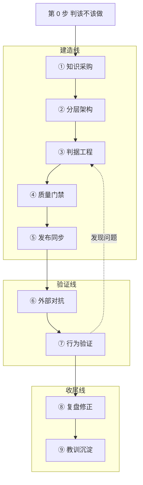

<div align="center">
  <h1>build-expert（造领域专家包）</h1>
  <p>把垂直领域的权威标准，做成"答错有后果、所以要经得起查"的 AI 专家包</p>
  <p>
    
    
    
    
    
  </p>
</div>

> **一句话**：把垂直领域的权威标准，做成一个能答专业问题、**每个关键数字都查得到出处**的 AI 专家包（专家或 Skill）。

> **它和「把文档喂给大模型」的区别**：不是知道得更多，而是**说得出依据，也说得出边界**。每条判据挂来源条款 ＋ 核验层级 ＋ 时效戳；前提不满足会劝退；缺依据时降级或拒答，而不是编一个看起来专业的数。九环节流水线 ＋ 18 条断言模式 ＋ 三张检查表，每个闸门都要证明**"坏内容会被拦"**——检查跑绿只说明当前这份过得了。

> **先看边界**：本技能**只装方法，不装任何领域内容**。领域知识留在你自己的专家包里；没有权威源可核验的领域，会被直接劝退——见[什么时候该用](#什么时候该用)。

> **30 秒上手**：把 `build-expert/` 整个目录放进宿主的技能目录即可。纯 Markdown，**不需要 API Key、不需要脚本库、不需要第三方依赖**。

## 3 分钟上手

```sh
# macOS / Linux
git clone https://github.com/eiway112/build-expert.git
cp -r build-expert ~/.claude/skills/build-expert
```

```powershell
# Windows（PowerShell）
git clone https://github.com/eiway112/build-expert.git
New-Item -ItemType Directory -Force "$env:USERPROFILE\.claude\skills" | Out-Null
Copy-Item -Recurse build-expert "$env:USERPROFILE\.claude\skills\build-expert"
```

目录名必须保持 `build-expert`（与 `SKILL.md` 的 `name` 字段一致），否则宿主可能识别不到。其他宿主只需换目标目录：

| 宿主 | 放置位置 |
|---|---|
| Claude Code（个人级 / 项目级） | `~/.claude/skills/build-expert/` 或 `<项目>/.claude/skills/build-expert/` |
| WorkBuddy（个人级 / 项目级） | `~/.workbuddy/skills/build-expert/` 或 `<项目>/.workbuddy/skills/build-expert/` |
| 其他支持 `SKILL.md` 的宿主 | 对应的 skills 目录，规则同上 |

**装完怎么验**：直接说一句"帮我做一个 XX 领域专家包"，能触发即为装好。宿主按 `SKILL.md` 的 `description` 匹配，不需要注册、不需要配置、不需要重启服务。

## 这是什么

技能遵循通用的 `SKILL.md` 约定（YAML frontmatter ＋ Markdown 正文），任何支持该约定的宿主都能加载。它管的是**从零到交付一个领域专家包的全过程**：先判该不该做，再走知识采购、分层架构、判据工程、质量门禁、发布同步，然后做外部对抗与行为验证，最后复盘修正与教训沉淀。

| 项 | 说明 |
|---|---|
| **解决的问题** | 领域问答里最贵的错误不是"不会答"，是**"看着像对的错答案"** |
| **适用前提** | 这个领域**答错了有后果**——有人照它开药 / 验收 / 起草 |
| **交付物** | 专家包 / 技能包（专家或 Skill）；本技能只提供方法与检查表 |
| **运行环境** | 能读文件、能版本控制即成立。缺脚本执行 ⇒ ④ 降级为人工过表；缺独立会话 ⇒ ⑦ 降级为换人复核。**降了哪一级必须写进产物，不标注＝默认它通过了** |

## 什么时候该用

只问一句：**这个领域答错了有后果吗？**

| 你说 | 用不用 | 为什么 |
|---|---|---|
| "帮我做一个消防验收专家包" | **用** | 有现行国标可核，答错要出事 |
| "把限值条文做成能查、能引的包" | **用** | 条款可定位、时效可核 |
| "验收一下同事给的专家包能不能当依据" | **用** | 走验收支线，判「可当依据 / 只当参考 / 不可用」 |
| "给我写个品牌文案助手" | **不用** | 对错由品味裁决，判据会变成伪装成标准的偏好 |
| "把今天的行情数据沉淀成知识库" | **不用** | 变得比标准快，时效戳永远在追 |
| "帮我做个查资料的检索库" | **不用** | 没人照它决策，判据链与门禁的成本收不回来 |

### 四类明确别用的情况

| 情况 | 为什么别用 | 该用什么 |
|---|---|---|
| **没有权威源**（创意、文案、头脑风暴、个人经验、行业潜规则） | 引用链无处可挂，三件套永远填不满 | 普通知识库 / 提示词模板 |
| **对错由品味裁决**（审美、文风、品牌调性） | "判据"会变成把个人偏好伪装成标准 | 人工评审 ＋ 风格指南 |
| **变得比标准快**（实时行情、当日政策、征求意见稿） | 等你复核完它已经变了，时效戳永远在追 | 直连数据源，别沉淀成包 |
| **只是给人查资料**（没人照它决策） | 判据链、门禁、验证的成本收不回来 | 检索型知识库就够 |

**再追问一句，能排除大多数误用** —— 挑一句你准备写进包的结论，问「**它要是错了，能拿哪一份文件证明它错？**」。答不出 ⇒ 权威源这个硬前提不成立，后面全是空转。

**规模提醒**：包很小（几十条、自用、短期）也别上全套，按[按规模取舍](#按规模取舍)只做 ①~③ ＋ ⑦ 一轮即可。

**误用信号**：开始给一条结论**编**"来源条款"，说明它本来就不该进这个包。

## 目录

- [3 分钟上手](#3-分钟上手)
- [这是什么](#这是什么)
- [什么时候该用](#什么时候该用)
- [你问，技能做什么](#你问技能做什么)
- [全流程：九环节](#全流程九环节)
- [它管什么](#它管什么)
- [按规模取舍](#按规模取舍)
- [三条铁律](#三条铁律)
- [和普通做法差在哪](#和普通做法差在哪)
- [设计原则](#设计原则)
- [文件构成](#文件构成)
- [边界：装什么，不装什么](#边界装什么不装什么)
- [它是怎么被验证的](#它是怎么被验证的)
- [仓库与反馈](#仓库与反馈)
- [版本与迭代](#版本与迭代)
- [许可](#许可)

## 你问，技能做什么

| 你问 | 技能做什么 |
|---|---|
| "这领域能不能做成专家包？" | 判三前提（权威源 / 拍板人 / 执行环境），缺权威源直接劝退，缺拍板人降级并标注 |
| "标准收了一堆，怎么变成能答问题的？" | 先写禁入清单 → 定六层架构 → 一条结论挂三件套（来源条款 / 核验层级 / 时效戳） |
| "怎么保证关键数字不出错？" | 断言即验收：每条要求配一条机器能判的检查，写完必须**注入缺陷**看它真会拦 |
| "做完了，怎么证明它真能用？" | 双会话行为验证：只看产物有没有落地，不看 AI 的自我评价 |
| "别人给了个专家包，能当依据吗？" | 验收追问四问（进化 / 对照 / 专业 / 降级）→ 三档结论 |
| "跑了一段时间，越用越乱" | 复盘修正（裁决带编号可追溯）＋ 教训四类分流 |

## 全流程：九环节



**不要求一次走完。** 绝大多数项目会在 ③ 判据工程 ↔ ④ 质量门禁 之间来回很多轮；⑥⑦ 发现问题就回灌 ③，改完判据再验一轮。

## 它管什么

一个入口管全程，按"你现在处在哪一步"自动路由，不需要记流程术语：

| 阶段 | 内容 |
|---|---|
| **该不该做** | 三前提判据（权威源 / 拍板人 / 执行环境）＋ 时间预算提醒；不满足就劝退或降级 |
| **怎么搭** | 知识采购（买方法不买内容、禁入清单前置）→ 分层架构（六层职责 ＋ 单一事实源）→ 判据工程（来源 ＋ 层级 ＋ 时效戳） |
| **怎么不翻车** | 质量门禁（断言即验收、缺陷注入）→ 发布与同步（单一事实源、公开私有分流） |
| **怎么证明它行** | 外部对抗（多模型独立意见 ＋ 报告逐条核真伪）→ 行为验证（双会话，测"做到没有"而非"写没写"） |
| **怎么持续** | 复盘修正（裁决可追溯、条件规则自失效）→ 教训沉淀（环境类进技能 / 领域类进手册 / 偏好类进记忆 / **元层类进方法文件**，四类分流） |

## 按规模取舍

包小（几十条判据、自用、短期）不必上全套；包大（对外发布、有人照它决策）⑦ 每轮必做。

三档（小 / 中 / 大）各自「必做」与「可轻做」的完整表，见 [`SKILL.md`「按规模取舍」](SKILL.md)（唯一定义点，此处只给指针）。

## 三条铁律

全程有效，不可省：

1. **回读为准** —— "命令执行成功了"不等于状态真的变了。
2. **每个闸门都要证明"坏的会被拦"** —— 检查全过只证明当前内容能过。
3. **"没查出问题"之前，先做阳性对照** —— 拿一个已知有问题的对象跑同一套判据，它必须报错。

每条铁律的完整表述、操作要求，以及它各自挡住的那类事故，见 [`SKILL.md`「三条铁律」](SKILL.md)（唯一定义点，此处只列名称与一句判据）。

## 和普通做法差在哪

多数人做知识包停在"把文档喂进去"。这套的差别在**把"对不对"变成可执行的判**：

| 环节 | 普通做法 | 本技能的做法 |
|---|---|---|
| **先决条件** | 先做，做着看 | **先判该不该做**：权威源 / 拍板人 / 执行环境三前提，缺一即劝退或降级并标注 |
| **知识条目** | 文档段落照搬 | 一条结论挂**三件套**：来源条款 ＋ 核验层级 ＋ 时效戳，缺一不合格 |
| **质量保证** | 人工抽查、看着没问题 | **断言即验收**：每条要求配一条机器能判的检查，且必须做过**缺陷注入** |
| **验证方式** | 看回答通顺不顺 | **双会话验行为**：不看 AI 的自我评价，只看产物有没有真的落地 |
| **被外部挑战时** | 参考别人的评审意见 | 外部结论**先当线索**：逐条核真伪，只许"相符 / 偏差 / 未核验"三档 |
| **发布之后** | 多份副本各自维护 | **单一事实源** ＋ 公开私有分流；判断"推没推成功"用远端回读 |
| **买错设备时** | 硬着头皮用 | 会**主动劝退**：不满足前提时说清代价，不让你白投入 |

## 设计原则

- **单一入口**：按"你现在在哪一步"路由，不要求记住任何流程术语。
- **零门槛**：模板里只有两类内容——原样照抄的，和 `{花括号}` 里填空的。
- **零硬编码**：核心流程不含任何本机路径、平台绑定或领域内容。
- **只装方法，不装内容**：领域知识留在你自己的专家包里，本技能提供的是可套用的结构、判据模式和检查表。

## 文件构成

| 文件 | 是什么 |
|---|---|
| `SKILL.md` | 技能本体：三道关（该不该做 / 怎么走 / 怎么不翻车）＋ 九环节流水线 ＋ 验收支线 ＋ 常见误区 |
| `references/knowledge-architecture.md` | 分层架构、判据字段、层级判定与时效戳档位的填空模板 |
| `references/assertion-patterns.md` | **18 条断言模式**（每条含判据、防什么、怎么套、误用对照） |
| `references/checklists.md` | **三张检查表**：开工前 8 问 / 动手改前 3 问 / 收工前 10 条 |
| `references/acceptance-review.md` | **验收追问四问**（进化 / 对照 / 专业 / 降级）：拿到现成专家包或技能合集时，判它「可当依据 / 只当参考 / 不可用」 |

一个技能本体 ＋ 四份 references，此外只有 `README`、`LICENSE`、`CHANGELOG` 与 `.gitattributes` 四个仓务文件。装进来的是方法，不是一堆示例文档。

## 边界：装什么，不装什么

| 类别 | 装（随技能分发） | 不装 |
|---|---|---|
| 方法 | `SKILL.md` ＋ 4 份 references | — |
| 领域内容 | — | 标准条文、限值、项目参数、检测数据 |
| 检查脚本 | — | 断言的具体实现（按你项目的判据写，本技能只给模式） |
| 过程记录 | — | 决策日志、核验报告、外部评审原稿 |
| 环境绑定 | — | 本机路径、宿主平台名、API Key |

**为什么这样切**：这些正是"换一个领域就失效"或"换一台机器就不成立"的东西。方法跨领域可复用，领域内容与运行记录不行——把它们混进来，包就从"通用方法"退化成"某个项目的遗留物"。

## 它是怎么被验证的

- **方法自指**：本技能自己的产出遵守它自己定的三条铁律——回读为准、闸门须证伪、零命中先做阳性对照。它的检查表在真实项目里被逐条执行过，不是写完就发布的文档。
- **模式来自实战**：18 条断言模式不是坐在桌前推演的，是在真实项目的门禁里逐条踩过、修过之后提炼的；每条都写清"防什么"与"误用对照"。
- **外部对抗**：核心结论经四家外部模型独立论证，逐条核真伪，只采纳"相符"项；同厂商模型会犯同一个错，多数票不算真理。

## 仓库与反馈

| 用途 | 地址 |
|---|---|
| **开发源**（修订、issue 全在这里） | https://github.com/eiway112/build-expert |
| 国内镜像（只读，不在此改内容） | https://gitee.com/eiway112/build-expert |
| 版本变更 | [CHANGELOG.md](CHANGELOG.md) |

> 镜像由开发源单向同步，Gitee 侧的改动会被下一次同步覆盖。

## 版本与迭代

- 按语义化版本打轻量 tag 发布，tag 与 `SKILL.md` 的 `version` 字段同名。引用请锁定到 tag 或具体 commit，避免跟随 main 拿到中间状态。
- 规范增补、判据修订以 PATCH 发布；新增环节或改变方法骨架以 MINOR 发布。
- 公开面变更逐条记入 [CHANGELOG.md](CHANGELOG.md)，写清动了哪个文件、为什么。

## 许可

MIT License，版权方 `eiway112`。详见 [LICENSE](LICENSE)。

## 一句话提醒

**最大的复用风险，是把某个项目跑出来的过程文档当模板直接抄。** 那些是演进史，里面大量中间态和已废弃方案。模板要从方法内核重新提炼——本技能即为该提炼的成品。
